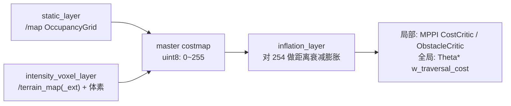

# 010. 🟡 `local_costmap` / `global_costmap` 参数与数学原理梳理

- **状态**：🟡 观察（梳理文档；其中 §7 列出若干配置疑点，待确认/待修）
- **发现日期**：2026-10-21
- **影响面**：导航行为与安全边界（当前无已确认故障，属分析记录）
- **相关文件**：
  - `src/pb2025_sentry_nav/pb2025_nav_bringup/config/reality/nav2_params.yaml:491-542`（local）
  - `src/pb2025_sentry_nav/pb2025_nav_bringup/config/reality/nav2_params.yaml:544-591`（global）
  - `src/pb2025_sentry_nav/pb_nav2_plugins/src/layers/intensity_voxel_layer.cpp`

## 现象

无故障现象。本文用于固化 costmap 各参数的**实际语义**（以 nav2 Humble 与仓库内自定义插件源码为准），避免后续按 YAML 中的过时注释误调参。

## 架构：分层代价地图

两个 costmap 均为 `LayeredCostmap`。每个更新周期先把 master grid 重置为默认值，再按 `plugins` 顺序逐层叠加：



代价语义（`nav2_costmap_2d` 约定）：

| 值 | 常量 | 含义 |
|---|---|---|
| 0 | `FREE_SPACE` | 自由 |
| 1–252 | — | 膨胀区，越靠近障碍越大 |
| 253 | `INSCRIBED_INFLATED_OBSTACLE` | 内切圆内，必撞 |
| 254 | `LETHAL_OBSTACLE` | 障碍 |
| 255 | `NO_INFORMATION` | 未知 |

## 1. 公共参数

| 参数 | local | global | 说明与数学含义 |
|---|---|---|---|
| `global_frame` | `odom` | `map` | 局部图随里程计漂移不跳变；全局图必须与静态图同系 |
| `robot_base_frame` | `gimbal_yaw_fake` | 同 | footprint 与 `footprint_clearing` 的参考系 |
| `rolling_window` | `true` | 未设（false） | local 原点跟随机器人 |
| `width` / `height` | 15 / 15 m | 未设 | 仅滚动窗口有效；global 尺寸由 `/map` 决定 |
| `resolution` | 0.05 | 0.05 | 栅格边长，同时是膨胀成本的量化步长 |
| `robot_radius` | 0.2 | 0.2 | **被 `footprint` 覆盖，实际不生效** |
| `footprint` | `[[-0.3,-0.3],[-0.3,0.3],[0.3,0.3],[0.3,-0.3]]` | 同 | 0.6×0.6 m 方形 |
| `update_frequency` | 25 Hz | 5 Hz | 40 ms / 200 ms 重算一次（reset → 各层 → 膨胀） |
| `publish_frequency` | 8 Hz | 2 Hz | 125 ms / 500 ms 发布一次 |
| `always_send_full_costmap` | false | false | 只发差分更新（更新包围盒内变化） |

### 1.1 栅格化数学

滚动窗口每个周期把原点设到机器人中心并**量化到整格**（`updateOrigin` 中
`static_cast<int>((new_o - old_o)/res)`），避免亚格位移导致整图重采样：

```
o_x = x_robot - W/2
o_y = y_robot - H/2
```

世界坐标与栅格索引：

```
i = floor((x - o_x) / resolution)
x ≈ o_x + i * resolution
```

由此得到本配置的规模：

```
局部栅格：15 / 0.05 = 300           → 300 x 300 = 9e4 cell，master ≈ 90 KB
体素层  ：每列一个 uint32            → 9e4 * 4B ≈ 360 KB
膨胀格数：0.65/0.05 = 13 格（local）、0.4/0.05 = 8 格（global）
```

### 1.2 footprint 的两个关键半径

对 `[-0.3,0.3]^2` 方形：

```
r_in  = min d(o, ∂F) = 0.3 m              内切半径（最窄可穿越半宽）
r_out = max ||v||    = 0.3 * sqrt(2) = 0.4243 m   外接半径（最远顶点）
```

- `r_in` 决定成本 253 的边界，也决定 MPPI `CostCritic.critical_cost: 253` 的"真碰撞"判定范围；
- `r_out` 是"完全安全"的期望膨胀半径下界。

## 2. `intensity_voxel_layer`（自定义体素层）

实现：`src/pb2025_sentry_nav/pb_nav2_plugins/src/layers/intensity_voxel_layer.cpp`

### 2.1 存储与 3D 栅格化

`nav2_voxel_grid` 用**每 (x,y) 列一个 `uint32`**：高 16 位 = marked 位图，低 16 位 = unknown 位图，
因此 **`z_voxels` 必须 ≤ 16**。

```
m_z = floor((z - origin_z) / z_resolution)     # m_x, m_y 同理
```

竖直覆盖范围：

```
z ∈ [origin_z, origin_z + z_voxels * z_resolution)
  = [0, 0 + 16 * 0.05) = [0, 0.8) m
```

标记判定（`voxel_grid.hpp:99-117`，`bitsBelowThreshold` 统计置位数）：

```
occupied(x,y) := #{marked voxels in this column} > mark_threshold
```

- `mark_threshold: 0` → 单点即置 254，无竖直去噪能力（对噪点/地面残留敏感）。

### 2.2 点的过滤链（按代码顺序，`updateBounds`）

每个点 `p = (x, y, z, intensity)` 依次通过：

1. 高度：`min_obstacle_height ≤ z ≤ max_obstacle_height`（**层**级参数）
2. 强度：`min_obstacle_intensity ≤ intensity ≤ max_obstacle_intensity`（`cpp:145`）
3. 距离：`||p - p_sensor||^2` 落在 `(obstacle_min_range², obstacle_max_range²)` —— 3D 距离，含高度
4. 3D 栅格化成功（`cpp:162-165`；越界丢弃；`z < origin_z` 时 clamp 到 `origin_z` 层）

> `intensity` 的物理含义不是反射率，而是 `terrain_analysis` 输出的**相对地面高度**
> （见 YAML `:520` 注释），所以强度阈值实际是第二道高度阈值。

### 2.3 易误解参数

| 参数 | 实际行为 |
|---|---|
| `combination_method: 1` | nav2 Humble `obstacle_layer.cpp` 中 `case 0: // Overwrite`、`case 1: // Maximum`。YAML 注释（"0=最大值、1=覆盖"）**写反了**。当前 1=Max：`master = max(master, layer)` 且 layer 的 255 被跳过，因此不会把静态图的未知区涂掉 —— 是正确选择 |
| 层内 `track_unknown_space` | `ObstacleLayer::onInitialize` 读取的是**顶层** `track_unknown_space`，嵌套在插件下的这份不生效。local 未设顶层 → false（空白为 FREE）；global 顶层为 true |
| `unknown_threshold: 5` | 本插件只在 `cpp:49-50` 声明，`updateBounds` 只用 `markVoxelInMap`，该值**未被使用**；其本义也不是注释写的"强度阈值" |
| `footprint_clearing_enabled` | 层内把 footprint 写成 0，但在 Max 组合下不降低 master 的值，实际**不清除**静态障碍；且插件每个周期 `resetMaps()` |

另：插件在 `updateBounds` 开头调用 `resetMaps()`（`cpp:109`），**无 raytrace 清除**，
障碍只保留最新一帧点云，消失完全依赖上游 `terrain_analysis`。

## 3. `inflation_layer`

### 3.1 成本衰减公式

见 nav2 `nav2_costmap_2d/include/nav2_costmap_2d/inflation_layer.hpp` 的 `computeCost()`：

```
C(d) = 254                                   d = 0                （障碍本身）
C(d) = 253                                   0 < d <= r_in         （内切圆内）
C(d) = 252 * exp(-k * (d - r_in))            r_in < d <= r_infl    （软膨胀）
C(d) = 0                                     d > r_infl            （硬截断）
```

其中 `d` 为米、`k = cost_scaling_factor`。要点：

- 膨胀只在 `(r_in, r_infl]` 上提供可微的软场，是 MPPI / Theta* 的"梯度坡度"；
- `k` 越大 → 衰减越快 → 薄而陡，规划更愿意贴障；`k` 越小 → 厚而缓，排斥范围大但梯度平缓；
- 边界成本不为 0：`C(r_infl) = 252 * exp(-k*(r_infl - r_in))`，`inflation_radius` 是硬截断半径。

### 3.2 实现算法

1. 收集 master 中所有 254（`inflate_unknown: false`，255 不参与膨胀）；
2. 分桶队列（按整数距离分级的 Dijkstra / BFS）向 4 邻域扩散，距离用
   `hypot(dx, dy) * resolution` 的缓存表，同一 cell 只处理一次；
3. 与 master 合并：`master = max(master, cost)`。

### 3.3 本配置数值

| d (m) | 0.30 | 0.35 | 0.40 | 0.45 | 0.50 | 0.55 | 0.60 | 0.65 |
|---|---|---|---|---|---|---|---|---|
| local（k=5.5） | 253 | 191 | 145 | 110 | 84 | 64 | 48 | 37（截断） |
| global（k=10） | 253 | 153 | 93 | >0.4 截断为 0 | | | | |

策略含义：

- local `0.65 / 5.5`：约 `r_out + 0.22 m` 余量，衰减较缓，给 MPPI 一个较宽的软墙；
- global `0.4 / 10`：薄而陡，只让全局路径别贴障；防撞主要靠 `static_layer` +
  Theta* 的 `w_traversal_cost: 15`。

## 4. 局部 vs 全局对照

| 维度 | local_costmap | global_costmap |
|---|---|---|
| 坐标系 | `odom`（无跳变） | `map`（与静态图一致） |
| 窗口 | 滚动 15×15 m | 全图（随 `/map` 尺寸） |
| 频率 | 25 / 8 Hz | 5 / 2 Hz |
| 点云源 | `/terrain_map`，0.3–3.0 m，`base_footprint` | `/terrain_map_ext`，0.4–5.0 m，`right_lidar` |
| 高度窗（层） | 0.03–2.0（受体素顶限制实际 ≤0.8） | 0.05–1.5（实际 0.1–0.8） |
| 强度窗 | 0.05–1.8（放过低矮障碍） | 0.15–15（尽量让动态障碍进全局图） |
| 膨胀 | 0.65 / k=5.5 | 0.4 / k=10 |
| 消费者 | MPPI critics（`CostCritic` 253 才判碰撞；`ObstacleCritic` 用 `collision_margin_distance: 0.30` 近似圆） | Theta* `w_traversal_cost: 15`、`dynamic_obstacle_inflation: 5.0` |

## 5. 疑点清单

| # | 疑点 | 证据 | 建议 |
|---|---|---|---|
| 5.1 | 全局 `inflation_radius: 0.4 < r_out = 0.4243`，45° 斜向接近墙体时外接点可能先于膨胀边界碰障；nav2 只在 `< r_in` 时报错，此处无告警 | YAML `:590`、`:554` | 调到 ≥ 0.45 |
| 5.2 | 体素竖直只覆盖 0.8 m，`max_obstacle_height: 1.5/2.0` 实际无效，高于 0.8 m 的点在 `worldToMap3D` 越界被丢弃 | `z_voxels: 16`、`z_resolution: 0.05`、`origin_z: 0.0`（`:514-517`、`:565-568`） | 改 `z_voxels: 24~32` 或 `origin_z: -0.2` |
| 5.3 | `mark_threshold: 0` 单点即致命，噪点/自车点易成为障碍 | YAML `:513`、`:564`；`voxel_grid.hpp:99-117` | 试 1–2，并配合 `min_obstacle_intensity` |
| 5.4 | `combination_method` 注释与源码相反，易被误改 | YAML `:512`、`:563`；`obstacle_layer.cpp` | 修正注释 |
| 5.5 | `unknown_threshold` 是死参数 | `intensity_voxel_layer.cpp:49-50`（仅声明） | 删除或注明未使用 |
| 5.6 | `footprint_clearing_enabled` 在 Max 组合下无效，自车点靠 `obstacle_min_range: 0.3` 过滤，但外接半径 0.42 > 0.3，角落仍可能被自身点云标记 | YAML `:510`、`:532`；`obstacle_layer.cpp` | 提高 `obstacle_min_range` 或改用 `use_footprint_clearing` 的外部方案 |
| 5.7 | 每帧 `resetMaps()` + 无 raytrace，障碍不保留历史，动态障碍消失依赖上游 | `intensity_voxel_layer.cpp:109` | 确认 `terrain_analysis` 的跟踪能力 |
| 5.8 | local 25 Hz 全图 memset（9e4 cell）+ 体素重建，CPU 开销可观 | YAML `:495` | 视 CPU 占用下调 `update_frequency` 至 15–20 Hz |

## 6. 验证方法

```bash
# 1) 确认实际生效参数（含 footprint 是否覆盖 robot_radius）
ros2 param get /local_costmap/local_costmap footprint
ros2 param get /global_costmap/global_costmap inflation_layer.inflation_radius

# 2) 确认层顺序与插件加载
ros2 param get /local_costmap/local_costmap plugins

# 3) 观察代价地图更新/发布频率
ros2 topic hz /local_costmap/costmap
ros2 topic hz /global_costmap/costmap

# 4) 把代价图落到 PGM 检查膨胀形态
ros2 run nav2_map_server map_saver_cli -f /tmp/local_costmap \
  --ros-args -p map_topic:=/local_costmap/costmap

# 5) 体素调参后确认竖直覆盖
ros2 param set /local_costmap/local_costmap intensity_voxel_layer.z_voxels 24
```

## 7. 相关文件

- `src/pb2025_sentry_nav/pb2025_nav_bringup/config/reality/nav2_params.yaml`（costmap 配置）
- `src/pb2025_sentry_nav/pb_nav2_plugins/src/layers/intensity_voxel_layer.cpp`（体素层实现）
- `src/pb2025_sentry_nav/pb_nav2_plugins/include/pb_nav2_plugins/layers/intensity_voxel_layer.hpp`
- nav2 Humble 上游：`nav2_costmap_2d/plugins/obstacle_layer.cpp`（`combination_method`）、
  `nav2_costmap_2d/include/nav2_costmap_2d/inflation_layer.hpp`（`computeCost`）、
  `nav2_voxel_grid/include/nav2_voxel_grid/voxel_grid.hpp`（体素位图与阈值）

## 处理记录

| 日期 | 处理人 | 改动 / 结论 |
|------|--------|-------------|
| 2026-10-21 | — | 录入参数与数学原理梳理；§5 疑点全部未修改，待确认 |
